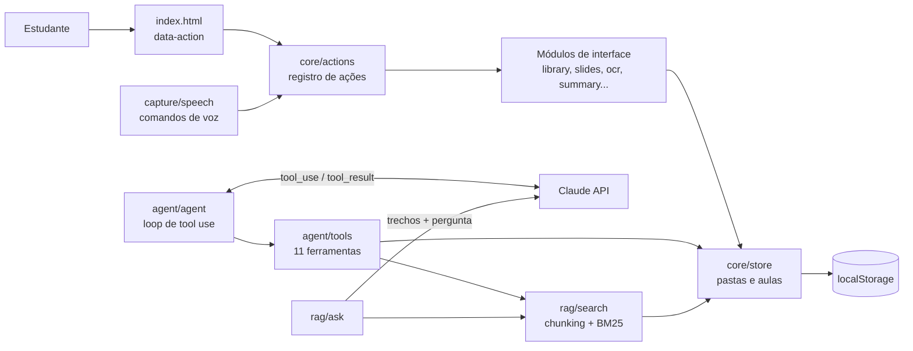

# 📚 EstudaAI

[](https://github.com/anakarollina19/estudaai/actions/workflows/tests.yml)

Assistente de estudos com IA para estudantes: transforma aulas (fotos do quadro, áudio, anotações e vídeos) em resumos, mapas mentais, flashcards, slides interativos e PDFs. Inclui um **agente de IA com ferramentas** e **busca nas próprias aulas (RAG)**.

> Projeto de portfólio que mostra **LLMs**, **AI Agents (tool use)** e **RAG** aplicados a um problema real, num app web modular, sem etapa de build, com testes automatizados.

**▶️ App online:** https://anakarollina19.github.io/estudaai/ — clique em **“✨ Experimentar com aulas de exemplo”** e, na aba **🤖 Agente**, em **“▶️ Ver uma demonstração”** para ver o agente trabalhando sem precisar de chave.

## Funcionalidades

| Área | O que faz |
|---|---|
| 🤖 **Agente de estudos** | Recebe pedidos em linguagem natural ("organize minhas aulas por matéria e crie slides da aula de hoje") e decide sozinho quais ferramentas chamar, num loop de *tool use* com o Claude. Cada passo aparece na tela. |
| 🔎 **Pergunte às suas aulas (RAG)** | Divide anotações, transcrições e textos das fotos em trechos, busca por **palavras (BM25)**, por **significado (embeddings)** ou **híbrida**, e envia os melhores ao LLM, que responde **citando as fontes** `[1]`, `[2]`. |
| 📊 **Avaliação do RAG** | 30 perguntas com respostas esperadas medem Hit@k e MRR de cada método de busca ([resultados abaixo](#avaliação-do-rag)). |
| 📷 **Fotos do quadro** | OCR no navegador (Tesseract.js, português e inglês) + resumo. A imagem fica guardada e vira slide. |
| 🎤 **Áudio** | Transcrição ao vivo (Web Speech API), gravação e transcrição de arquivos (Whisper). |
| 🎙️ **Comandos de voz** | "nova aula", "resumo", "slides", "pesquisar …", "renomear para …". |
| ✨ **Resumo, mapa mental e flashcards** | Com LLM, ou offline por resumo extrativo (frequência de palavras-chave). |
| 🎞️ **Slides interativos** | Tópicos revelados um a um, tela cheia, imagens, "explique este slide", quiz e PDF. |
| 🗂️ **Organização** | Login, pastas, aulas com data e hora, renomear, mover, excluir, busca, backup e salvar numa pasta do computador. |
| 🖍️ **Quadro branco**, ▶️ **YouTube** e 🌐 **Google** ao lado das notas. |

## Arquitetura



**Decisões de projeto**
- **Uma ação, vários caminhos.** Cada módulo registra suas ações por nome (`slides.build`, `library.newFolder`...). Botões (`data-action`), comandos de voz e o agente chamam exatamente o mesmo código.
- **Regras separadas da interface.** `core/store.js` (dados), `rag/search.js` (busca) e `text/nlp.js` (texto) são funções puras, sem DOM. É isso que os testes cobrem.
- **Sem acoplamento entre telas.** Os módulos conversam por eventos (`lesson:open`, `tab:show`) em vez de se importarem uns aos outros.
- **Sempre há um plano B offline.** Sem chave de IA, resumo, slides e quiz usam processamento de texto local.

### Como o agente funciona ([`src/agent/agent.js`](src/agent/agent.js))
1. A mensagem do estudante vai para o Claude junto com as ferramentas (nome, descrição e JSON Schema, em [`tools.js`](src/agent/tools.js)).
2. O modelo responde com blocos `tool_use`; o app executa cada ferramenta sobre os dados do estudante.
3. Os resultados voltam como `tool_result` e o loop continua até o modelo responder só com texto (limite de 10 passos). Ferramenta desconhecida ou com erro vira uma mensagem para o modelo, não uma falha.

O loop recebe o modelo por injeção (`callModel`), então os testes usam um modelo falso e a demonstração usa um roteiro gravado, ambos executando as ferramentas de verdade.

### Como o RAG funciona ([`src/rag/`](src/rag/))
1. **Chunking:** notas divididas por tópico (`# título`) e parágrafo, em trechos de até 700 caracteres com 100 de sobreposição; cada foto do quadro vira um trecho.
2. **Recuperação**, em três modos:
   - **Palavras:** BM25 (k1 = 1,2; b = 0,75) com normalização de acentos e stopwords em português ([`search.js`](src/rag/search.js)).
   - **Significado:** embeddings do modelo multilíngue `paraphrase-multilingual-MiniLM-L12-v2`, rodando **no próprio navegador** com Transformers.js, e similaridade do cosseno ([`semantic.js`](src/rag/semantic.js)).
   - **Híbrida:** junta os dois rankings com *Reciprocal Rank Fusion* (c = 60).
3. **Geração:** os 5 melhores trechos vão numerados ao Claude, que só pode usá-los e deve citar as fontes. Cada fonte na tela abre a aula de origem.

## Avaliação do RAG

Para escolher o método de busca com dados e não no achismo, montei um conjunto de avaliação ([`eval/dataset.js`](eval/dataset.js)): **8 aulas** de Biologia, Química, História e Física e **30 perguntas**, cada uma com a aula e o trecho que contém a resposta.
- **16 literais** usam as palavras da aula ("Quais são as fases da mitose?").
- **14 paráfrases** dizem a mesma coisa com outras palavras ("Como uma célula vira duas iguais?").

Métricas: **Hit@k** é a fração das perguntas em que o trecho certo veio entre os *k* primeiros; **MRR** é a média de 1/posição do trecho certo. Como o RAG envia 5 trechos à IA, **Hit@5** é a chance de a IA receber a resposta.

| Método | Hit@1 | Hit@3 | Hit@5 | MRR | Hit@5 nas paráfrases |
|---|---:|---:|---:|---:|---:|
| BM25 (palavras) | 77% | 80% | 83% | 0,78 | 64% |
| Embeddings (significado) | **83%** | **97%** | **100%** | **0,91** | **100%** |
| Híbrida (RRF) | **83%** | **97%** | 97% | 0,89 | 93% |

**O que os números mostram**
- O BM25 é perfeito quando o aluno usa as palavras da aula (100% nas literais), mas perde **mais de um terço das paráfrases**: sem palavras em comum, ele não encontra nada.
- Os embeddings resolvem as paráfrases (64% → 100% de Hit@5), ao custo de baixar um modelo de ~120 MB e de errar um pouco mais a 1ª posição nas literais (87,5% contra 100%).
- A híbrida mantém 100% nas literais e quase todo o ganho nas paráfrases, mas, **neste conjunto**, não superou os embeddings sozinhos.
- Por isso o app deixa a busca por palavras como padrão (instantânea e offline) e oferece as outras duas como opção. Com só 30 perguntas a diferença entre embeddings e híbrida (1 pergunta) não é conclusiva; o próximo passo é aumentar o conjunto.

Para reproduzir, rode o servidor e abra http://localhost:8080/eval/. Um teste automatizado trava o BM25 em pelo menos 80% de Hit@5, para nenhuma mudança piorar a busca sem ninguém perceber.

## Estrutura

```
index.html            marcação (sem JavaScript inline)
css/styles.css        tema claro/escuro e layout responsivo
src/
  main.js             ponto de entrada: liga data-action às ações
  core/               actions, events, store (dados), dom, files, util
  text/nlp.js         normalização, frases, palavras-chave, tópicos, resumo offline
  ai/claude.js        cliente da API do Claude
  agent/              loop do agente + ferramentas
  rag/                busca BM25, embeddings, híbrida (RRF) + aba "Pergunte às aulas"
  capture/            OCR das fotos, áudio/Whisper, voz
  study/              resumo, mapa mental, flashcards, PDF
  slides/slides.js    slides interativos
  library.js          pastas, aulas, notas e backup
  board.js  web.js  tabs.js  auth.js  demo.js
eval/                 conjunto de avaliação, métricas e página de resultados
tests/                31 testes (texto, RAG, avaliação, store e agente) + runner do CI
.github/workflows/    testes automáticos a cada push
scripts/serve.ps1     servidor local para Windows
```

## Como rodar

Os módulos JavaScript precisam ser servidos por HTTP (abrir o arquivo direto não funciona):

```bash
# Windows, sem instalar nada
powershell -ExecutionPolicy Bypass -File scripts/serve.ps1
# ou, com Python
python -m http.server 8080
```

Abra http://localhost:8080. Para os recursos de IA, clique em **⚙️ Chave de IA** e cole uma chave da [API do Claude](https://console.anthropic.com/) (e, para transcrever arquivos de áudio, uma da OpenAI). As chaves ficam só no seu navegador.

## Testes

Com o servidor rodando, abra http://localhost:8080/tests/. São 31 testes sem dependências, cobrindo:
- **texto:** acentos, stopwords, divisão em frases, tópicos e resumo offline;
- **RAG:** chunking com sobreposição, ranking BM25, busca sem acentos, fusão RRF e montagem do prompt com fontes;
- **avaliação:** Hit@k, MRR, consistência do conjunto de perguntas e uma trava contra piora do BM25;
- **dados:** criar, mover e excluir aulas e pastas sem duplicar;
- **agente:** execução de ferramentas, ferramenta desconhecida, limite de passos e formato das especificações.

No GitHub, o workflow [`tests.yml`](.github/workflows/tests.yml) roda os mesmos testes num Chrome sem janela (Playwright) a cada push.

## Tecnologias
JavaScript (ES modules) · Claude API (tool use) · Transformers.js (embeddings) · Tesseract.js · jsPDF · Web Speech API · MediaRecorder · File System Access API · Canvas · Playwright + GitHub Actions

## Limitações e próximos passos
- **Backend em Python (FastAPI)** para guardar a chave da API no servidor e rodar o agente e o RAG lá.
- **Conjunto de avaliação maior** (com perguntas reais de estudantes) e avaliação também das respostas geradas, não só da recuperação.
- **Guardar os embeddings** das aulas em IndexedDB, para não recalcular a cada busca.
- Os dados ficam no navegador (`localStorage`, ~5 MB). Próximo passo: sincronizar na nuvem (Supabase ou Firebase) e guardar imagens no IndexedDB.
