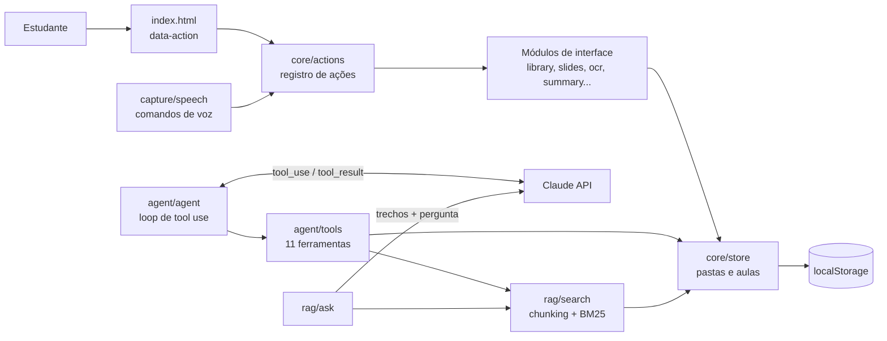

# 📚 EstudaAI

Assistente de estudos com IA para estudantes: transforma aulas (fotos do quadro, áudio, anotações e vídeos) em resumos, mapas mentais, flashcards, slides interativos e PDFs. Inclui um **agente de IA com ferramentas** e **busca nas próprias aulas (RAG)**.

> Projeto de portfólio que mostra **LLMs**, **AI Agents (tool use)** e **RAG** aplicados a um problema real, num app web modular, sem etapa de build, com testes automatizados.

**▶️ App online:** https://anakarollina19.github.io/estudaai/ — clique em **“✨ Experimentar com aulas de exemplo”** e, na aba **🤖 Agente**, em **“▶️ Ver uma demonstração”** para ver o agente trabalhando sem precisar de chave.

## Funcionalidades

| Área | O que faz |
|---|---|
| 🤖 **Agente de estudos** | Recebe pedidos em linguagem natural ("organize minhas aulas por matéria e crie slides da aula de hoje") e decide sozinho quais ferramentas chamar, num loop de *tool use* com o Claude. Cada passo aparece na tela. |
| 🔎 **Pergunte às suas aulas (RAG)** | Divide anotações, transcrições e textos das fotos em trechos, ranqueia com **BM25** e envia os melhores ao LLM, que responde **citando as fontes** `[1]`, `[2]`. |
| 📷 **Fotos do quadro** | OCR no navegador (Tesseract.js, português e inglês) + resumo. A imagem fica guardada e vira slide. |
| 🎤 **Áudio** | Transcrição ao vivo (Web Speech API), gravação e transcrição de arquivos (Whisper). |
| 🎙️ **Comandos de voz** | "nova aula", "resumo", "slides", "pesquisar …", "renomear para …". |
| ✨ **Resumo, mapa mental e flashcards** | Com LLM, ou offline por resumo extrativo (frequência de palavras-chave). |
| 🎞️ **Slides interativos** | Tópicos revelados um a um, tela cheia, imagens, "explique este slide", quiz e PDF. |
| 🗂️ **Organização** | Login, pastas, aulas com data e hora, renomear, mover, excluir, busca, backup e salvar numa pasta do computador. |
| 🖍️ **Quadro branco**, ▶️ **YouTube** e 🌐 **Google** ao lado das notas. |

## Arquitetura



**Decisões de projeto**
- **Uma ação, vários caminhos.** Cada módulo registra suas ações por nome (`slides.build`, `library.newFolder`...). Botões (`data-action`), comandos de voz e o agente chamam exatamente o mesmo código.
- **Regras separadas da interface.** `core/store.js` (dados), `rag/search.js` (busca) e `text/nlp.js` (texto) são funções puras, sem DOM. É isso que os testes cobrem.
- **Sem acoplamento entre telas.** Os módulos conversam por eventos (`lesson:open`, `tab:show`) em vez de se importarem uns aos outros.
- **Sempre há um plano B offline.** Sem chave de IA, resumo, slides e quiz usam processamento de texto local.

### Como o agente funciona ([`src/agent/agent.js`](src/agent/agent.js))
1. A mensagem do estudante vai para o Claude junto com as ferramentas (nome, descrição e JSON Schema, em [`tools.js`](src/agent/tools.js)).
2. O modelo responde com blocos `tool_use`; o app executa cada ferramenta sobre os dados do estudante.
3. Os resultados voltam como `tool_result` e o loop continua até o modelo responder só com texto (limite de 10 passos). Ferramenta desconhecida ou com erro vira uma mensagem para o modelo, não uma falha.

O loop recebe o modelo por injeção (`callModel`), então os testes usam um modelo falso e a demonstração usa um roteiro gravado, ambos executando as ferramentas de verdade.

### Como o RAG funciona ([`src/rag/search.js`](src/rag/search.js))
1. **Chunking:** notas divididas por tópico (`# título`) e parágrafo, em trechos de até 700 caracteres com 100 de sobreposição; cada foto do quadro vira um trecho.
2. **Recuperação:** BM25 (k1 = 1,2; b = 0,75) com normalização de acentos e stopwords em português, sem servidor nem embeddings.
3. **Geração:** os 5 melhores trechos vão numerados ao Claude, que só pode usá-los e deve citar as fontes. Cada fonte na tela abre a aula de origem.

## Estrutura

```
index.html            marcação (sem JavaScript inline)
css/styles.css        tema claro/escuro e layout responsivo
src/
  main.js             ponto de entrada: liga data-action às ações
  core/               actions, events, store (dados), dom, files, util
  text/nlp.js         normalização, frases, palavras-chave, tópicos, resumo offline
  ai/claude.js        cliente da API do Claude
  agent/              loop do agente + ferramentas
  rag/                busca BM25 + aba "Pergunte às aulas"
  capture/            OCR das fotos, áudio/Whisper, voz
  study/              resumo, mapa mental, flashcards, PDF
  slides/slides.js    slides interativos
  library.js          pastas, aulas, notas e backup
  board.js  web.js  tabs.js  auth.js  demo.js
tests/                24 testes (texto, RAG, store e agente)
scripts/serve.ps1     servidor local para Windows
```

## Como rodar

Os módulos JavaScript precisam ser servidos por HTTP (abrir o arquivo direto não funciona):

```bash
# Windows, sem instalar nada
powershell -ExecutionPolicy Bypass -File scripts/serve.ps1
# ou, com Python
python -m http.server 8080
```

Abra http://localhost:8080. Para os recursos de IA, clique em **⚙️ Chave de IA** e cole uma chave da [API do Claude](https://console.anthropic.com/) (e, para transcrever arquivos de áudio, uma da OpenAI). As chaves ficam só no seu navegador.

## Testes

Com o servidor rodando, abra http://localhost:8080/tests/. São 24 testes sem dependências, cobrindo:
- **texto:** acentos, stopwords, divisão em frases, tópicos e resumo offline;
- **RAG:** chunking com sobreposição, ranking BM25, busca sem acentos e montagem do prompt com fontes;
- **dados:** criar, mover e excluir aulas e pastas sem duplicar;
- **agente:** execução de ferramentas, ferramenta desconhecida, limite de passos e formato das especificações.

## Tecnologias
JavaScript (ES modules) · Claude API (tool use) · Tesseract.js · jsPDF · Web Speech API · MediaRecorder · File System Access API · Canvas

## Limitações e próximos passos
- **Backend em Python (FastAPI)** para guardar a chave da API no servidor e rodar o agente e o RAG lá.
- **Embeddings** no RAG, para buscar por sentido ("divisão celular" encontrar "mitose") e não só por palavras.
- **Avaliação do RAG:** conjunto de perguntas com respostas esperadas e métricas de acerto da recuperação.
- **Testes no CI** com GitHub Actions.
- Os dados ficam no navegador (`localStorage`, ~5 MB). Próximo passo: sincronizar na nuvem (Supabase ou Firebase) e guardar imagens no IndexedDB.
