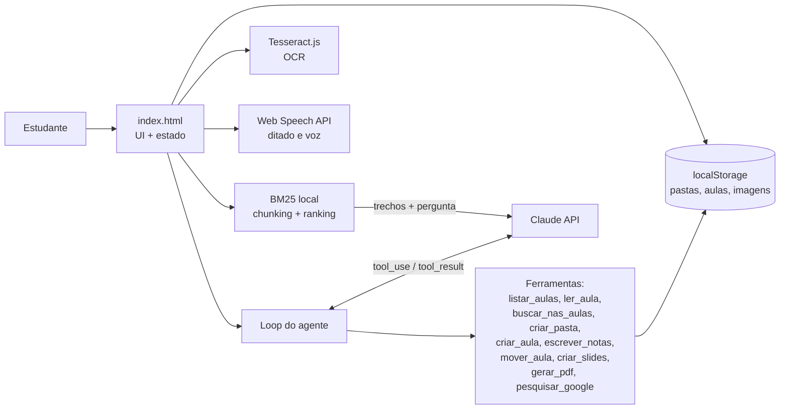

# 📚 EstudaAI

Assistente de estudos com IA para estudantes: transforma aulas (fotos do quadro, áudio, anotações e vídeos) em resumos, mapas mentais, flashcards, slides interativos e PDFs. Inclui um **agente de IA com ferramentas** e **busca nas próprias aulas (RAG)**.

> Projeto de portfólio que mostra **LLMs**, **AI Agents (tool use)** e **RAG** aplicados a um problema real, num app web sem servidor (um único `index.html`).

## Funcionalidades

| Área | O que faz |
|---|---|
| 🤖 **Agente de estudos** | Recebe pedidos em linguagem natural ("organize minhas aulas por matéria e crie slides da aula de hoje") e decide sozinho quais ferramentas chamar, num loop de *tool use* com o Claude. Cada passo aparece na tela. |
| 🔎 **Pergunte às suas aulas (RAG)** | Divide anotações, transcrições e textos das fotos em trechos, ranqueia com **BM25** e envia os melhores ao LLM, que responde **citando as fontes** `[1]`, `[2]`. |
| 📷 **Fotos do quadro** | OCR no navegador (Tesseract.js, português e inglês) + resumo. A imagem fica guardada e vira slide. |
| 🎤 **Áudio** | Transcrição ao vivo (Web Speech API), gravação e transcrição de arquivos (Whisper). |
| 🎙️ **Comandos de voz** | "nova aula", "resumo", "slides", "pesquisar …", "renomear para …". |
| ✨ **Resumo, mapa mental e flashcards** | Com LLM, ou offline por resumo extrativo (frequência de palavras-chave). |
| 🎞️ **Slides interativos** | Tópicos revelados um a um, tela cheia, "explique este slide", quiz e PDF. |
| 🗂️ **Organização** | Login, pastas, aulas com data e hora, renomear, mover, excluir, busca, backup e salvar numa pasta do computador. |
| 🖍️ **Quadro branco**, ▶️ **YouTube** e 🌐 **Google** ao lado das notas. |

## Arquitetura

### Como o agente funciona
1. A mensagem do estudante vai para o Claude junto com a lista de ferramentas (nome, descrição, JSON Schema).
2. O modelo responde com blocos `tool_use`; o app executa cada ferramenta localmente sobre os dados do estudante.
3. Os resultados voltam como `tool_result` e o loop continua (até 10 passos) até o modelo responder só com texto.

### Como o RAG funciona
1. **Chunking**: notas divididas por tópico (`# título`) e parágrafo, em trechos de até ~700 caracteres; cada foto vira um trecho.
2. **Recuperação**: BM25 com normalização de acentos e stopwords em português, sem precisar de embeddings nem servidor.
3. **Geração**: os 5 melhores trechos vão numerados ao Claude, com a instrução de responder só com base neles e citar as fontes.

## Como rodar

Abra o `index.html` no Chrome ou Edge. Não precisa instalar nada.

Para os recursos de IA, clique em **⚙️ Chave de IA** e cole uma chave da [API do Claude](https://console.anthropic.com/) (e, se quiser transcrever arquivos de áudio, uma chave da OpenAI). As chaves ficam só no seu navegador.

Publicar no GitHub Pages: *Settings → Pages → Deploy from branch → main / root*.

## Tecnologias
HTML, CSS e JavaScript puro · Claude API (tool use) · Tesseract.js · jsPDF · Web Speech API · MediaRecorder · File System Access API · Canvas

## Limitações e próximos passos
- Os dados ficam no navegador (`localStorage`, ~5 MB). Próximo passo: sincronizar na nuvem (Supabase ou Firebase) e guardar imagens no IndexedDB.
- A chave de API é usada direto do navegador, o que serve para uso pessoal. Para produção, chamar a API por um backend.
- RAG com BM25: trocar por embeddings para buscar por sentido, não só por palavras.
