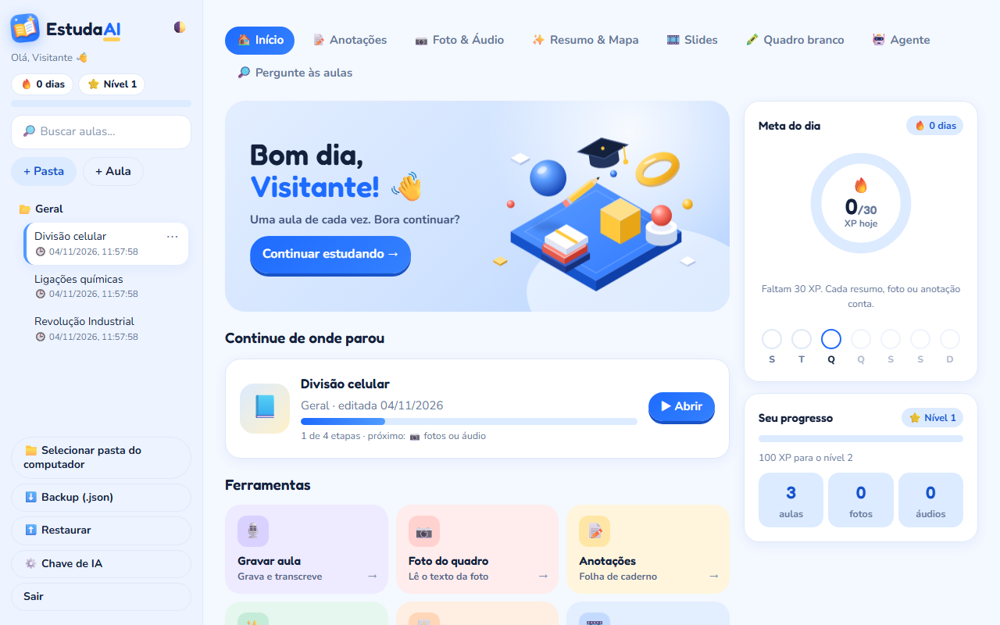
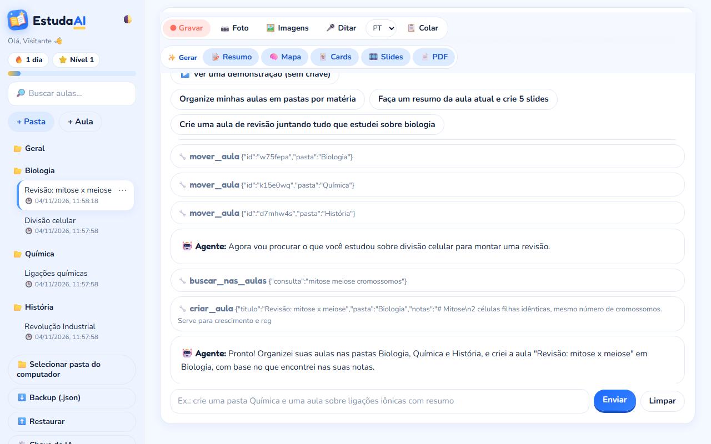
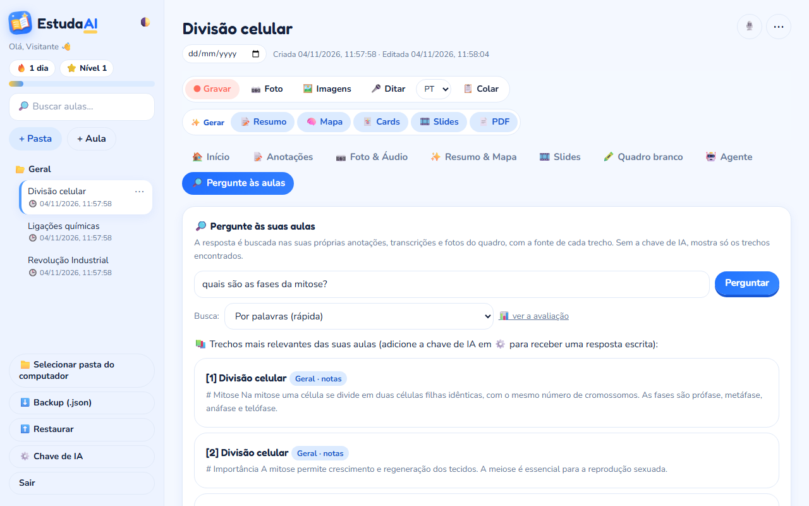
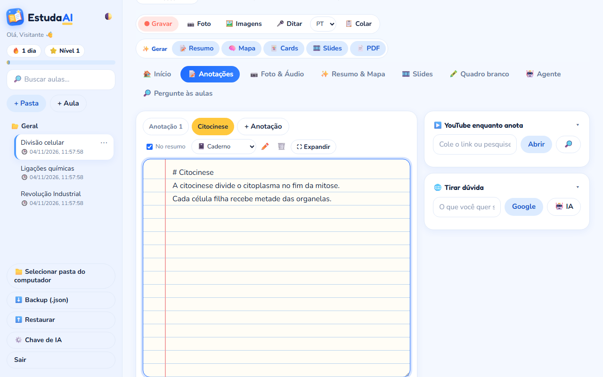
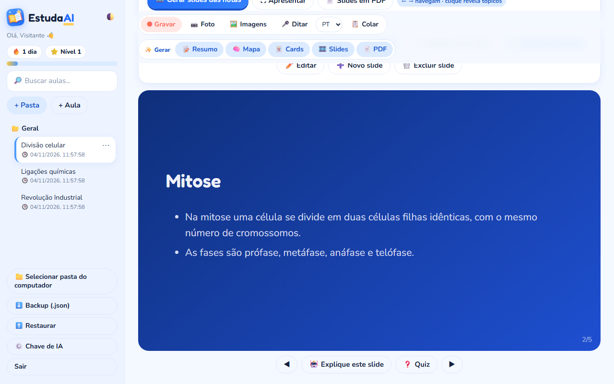
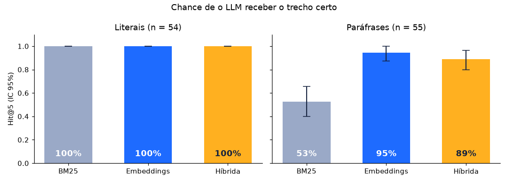
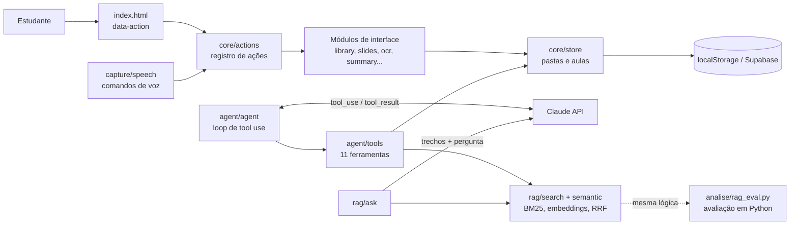

<p align="center">
  
</p>

<p align="center">
  <a href="https://github.com/anakarollina19/estudaai/actions/workflows/tests.yml"></a>
  
  
  
</p>

<h3 align="center">
  <a href="https://anakarollina19.github.io/estudaai/">▶️ Abrir o app</a> ·
  <a href="analise/analise_rag.ipynb">📊 Ver a análise</a> ·
  <a href="#avaliar">⏱️ Avaliar em 3 min</a> ·
  <a href="#resultados">📈 Resultados</a>
</h3>

<table align="center">
  <tr>
    <td align="center"><h2>97%</h2>de acerto no top 5<br>com embeddings</td>
    <td align="center"><h2>+42 p.p.</h2>em perguntas feitas<br>com outras palavras</td>
    <td align="center"><h2>p &lt; 0,0001</h2>diferença com<br>significância estatística</td>
    <td align="center"><h2>11</h2>ferramentas<br>do agente de IA</td>
    <td align="center"><h2>32</h2>testes automáticos<br>a cada push</td>
  </tr>
</table>

**Assistente de estudos com IA** que transforma aulas (anotações, fotos do quadro e áudio) em resumos, slides e flashcards, com um **agente de IA que usa ferramentas** e um **RAG avaliado estatisticamente** para responder dúvidas a partir das próprias aulas do estudante. Tudo roda no navegador, sem instalar nada.

<p align="center">
  
</p>

### 🖼️ Telas

<table>
  <tr>
    <td width="50%"><p align="center"><b>Início</b> · meta do dia, sequência e atalhos</p></td>
    <td width="50%"><p align="center"><b>Agente</b> · decide e executa as ferramentas</p></td>
  </tr>
  <tr>
    <td><p align="center"><b>Pergunte às aulas</b> · RAG com as fontes</p></td>
    <td><p align="center"><b>Anotações</b> · folha de caderno e captura simultânea</p></td>
  </tr>
  <tr>
    <td><p align="center"><b>Slides</b> · tópicos revelados um a um, quiz e PDF</p></td>
    <td><p align="center"><b>Login</b> · contas na nuvem com Supabase</p></td>
  </tr>
</table>

---

<a id="avaliar"></a>

## ⏱️ Para quem vai avaliar (3 minutos)

1. **Abra o [app](https://anakarollina19.github.io/estudaai/)** e clique em **“✨ Experimentar com aulas de exemplo”** (não precisa de conta nem de chave).
2. Na aba **🤖 Agente**, clique em **“▶️ Ver uma demonstração”**: o agente lista as aulas, cria pastas, move aulas, busca no conteúdo e escreve uma revisão, **executando as ferramentas de verdade**.
3. Na aba **🔎 Pergunte às aulas**, pergunte *“como uma célula vira duas iguais?”* e troque a busca entre **palavras**, **significado** e **híbrida**.
4. Leia o **[notebook de análise](analise/analise_rag.ipynb)**: avaliação de 127 perguntas com intervalos de confiança, testes de hipótese, experimentos e análise de erros.
5. Código principal: [loop do agente](src/agent/agent.js) · [ferramentas](src/agent/tools.js) · [busca BM25/RRF](src/rag/search.js) · [embeddings](src/rag/semantic.js) · [testes](tests/).

---

## O problema e a solução

Estudantes juntam material espalhado (caderno, fotos do quadro, áudios) e perdem tempo para revisar. O EstudaAI organiza tudo por aula e usa IA para **resumir, gerar material de estudo e responder dúvidas citando de onde veio cada resposta**.

O ponto crítico é a **recuperação**: se o RAG não encontra o trecho certo nas anotações, o LLM responde errado ou inventa. Por isso a busca foi tratada como um problema de ciência de dados: medida, comparada estatisticamente e ajustada com base em evidência.

## Duas frentes do projeto

| 📊 Base: ciência de dados | 🤖 Em alta: LLMs e agentes |
|---|---|
| Conjunto de avaliação com **127 perguntas** (literais, paráfrases e sem resposta) e gabarito com respostas múltiplas | **Agente com tool use** (Claude): 11 ferramentas com JSON Schema, loop com limite de passos e erros devolvidos ao modelo |
| **Intervalos de confiança por bootstrap**, **McNemar exato** e **permutação pareada** com correção de **Holm** | **RAG** com citação das fontes e três recuperadores: BM25, embeddings no navegador e híbrida (RRF) |
| Experimentos: granularidade dos trechos × custo de contexto, curva Hit@k, grade de hiperparâmetros do BM25 | LLM com **plano B offline** (resumo extrativo, quiz e slides sem IA) |
| **Detecção de pergunta sem resposta** com curva ROC (AUC ≈ 0,83) e escolha de limiar | **Whisper** e **OCR** rodando no navegador, sem servidor |
| Porta em Python **verificada contra o app** (mesmos números) e análise de erros que **encontrou um bug** | Agente testável: o modelo é injetado, então os testes usam um LLM falso |

## Resultados

Avaliação da recuperação em **109 perguntas com resposta** (18 aulas de 9 matérias), com IC de 95% por bootstrap:

| Método | Hit@1 | Hit@5 [IC 95%] | Hit@5 em paráfrases | MRR |
|---|---:|---:|---:|---:|
| BM25 (palavras) | 70% | 76% [68–84%] | 53% | 0,72 |
| Embeddings (significado) | 75% | **97%** [94–100%] | **95%** | 0,85 |
| Híbrida (RRF) | **78%** | 95% [90–98%] | 89% | **0,86** |



**O que os dados mostram**
- Nas perguntas **literais**, os três métodos acertam 100%. A diferença está toda nas **paráfrases**: **45% delas não têm nenhuma palavra em comum** com o trecho certo, e aí a busca por palavras não tem como achar.
- Embeddings e híbrida ganham do BM25 com **significância estatística** (McNemar exato, p < 0,0001 após Holm). Entre eles a diferença **não é significativa** (p = 0,5).
- Ajustar k1 e b do BM25 muda o MRR só de 0,718 para 0,724: o problema é de vocabulário, não de calibração.
- Trechos por **tópico** (o que o app usa) são o melhor equilíbrio: a aula inteira acerta 2 a 3 pontos a mais, mas manda **2,7× mais texto** ao LLM.
- O score do melhor trecho detecta perguntas **sem resposta** com AUC ≈ 0,83: um limiar de similaridade ~0,41 permite ao app dizer “não encontrei nas suas aulas” em vez de deixar o LLM inventar.
- A porta em Python revelou um **bug nas stopwords** do app (palavras com acento nunca eram removidas). O efeito medido foi nulo, mas o bug foi corrigido e ganhou teste.

**Decisão tomada a partir dos dados:** a busca híbrida tem o melhor 1º resultado e 95% de top 5, então é a candidata a padrão quando o modelo de embeddings estiver carregado, com o BM25 como plano B offline.

📓 Tudo isso, com gráficos, testes estatísticos, análise de erros e limitações, está em [`analise/analise_rag.ipynb`](analise/analise_rag.ipynb).

---

## Funcionalidades

| Área | O que faz |
|---|---|
| 🤖 **Agente de estudos** | Pedidos em linguagem natural (“organize minhas aulas por matéria e crie slides”); o modelo escolhe e encadeia ferramentas. Cada passo aparece na tela. |
| 🔎 **Pergunte às aulas (RAG)** | Busca por palavras, por significado ou híbrida nos trechos das anotações, transcrições e fotos; a resposta cita as fontes `[1]`, `[2]`. |
| 📷 **Fotos do quadro** | Até 100 por aula (IndexedDB), OCR no navegador e resumo; dá para juntar várias numa colagem em 1 slide. |
| 🎤 **Áudio** | Ditado ao vivo, gravação e transcrição de mp3, m4a, opus do WhatsApp... com Whisper no navegador (grátis) ou da OpenAI. |
| ⏺ **Captura simultânea** | Gravar, fotografar, ditar e colar enquanto escreve; fotos tiradas durante a gravação ficam marcadas com o minuto do áudio. |
| ✨ **Material de estudo** | Resumo, mapa mental, flashcards em 3D, slides interativos com quiz e PDF, com ou sem IA. |
| 🏠 **Início e gamificação** | Meta do dia, sequência de dias, XP e níveis. |
| ☁️ **Contas** | Supabase com Row Level Security e painel de admin, ou tudo local no aparelho. |

## Arquitetura



**Decisões de projeto**
- **Uma ação, vários caminhos:** botões, comandos de voz e o agente chamam o mesmo código, registrado por nome (`slides.build`, `library.newFolder`...).
- **Regras separadas da interface:** dados, busca e texto são funções puras, cobertas por testes.
- **Agente testável:** o loop recebe o modelo por injeção (`callModel`); os testes usam um LLM falso e a demonstração usa um roteiro gravado, ambos executando as ferramentas de verdade.
- **Medir o que roda em produção:** os embeddings da análise são gerados pelo próprio app (Transformers.js, modelo quantizado), e o BM25 em Python reproduz exatamente os números do app.

### Como o agente funciona ([`src/agent/agent.js`](src/agent/agent.js))
1. A mensagem vai ao Claude com as ferramentas (nome, descrição e JSON Schema, em [`tools.js`](src/agent/tools.js)).
2. O modelo responde com blocos `tool_use`; o app executa cada ferramenta sobre os dados do estudante.
3. Os resultados voltam como `tool_result` até o modelo responder só com texto (máx. 10 passos). Ferramenta desconhecida ou com erro vira mensagem para o modelo, não falha.

### Como o RAG funciona ([`src/rag/`](src/rag/))
1. **Chunking** por tópico (`# título`) e parágrafo; cada foto do quadro vira um trecho.
2. **Recuperação:** BM25 (k1 = 1,2; b = 0,75) com normalização de acentos; embeddings `paraphrase-multilingual-MiniLM-L12-v2` no navegador; ou híbrida com *Reciprocal Rank Fusion* (c = 60).
3. **Geração:** os 5 melhores trechos vão numerados ao Claude, que só pode usá-los e deve citar as fontes.

## Estrutura do projeto

```
index.html, css/          interface (sem framework, sem build)
src/
  agent/                  loop do agente + 11 ferramentas
  rag/                    BM25, embeddings, híbrida (RRF) e aba "Pergunte às aulas"
  ai/                     cliente do Claude e Transformers.js
  capture/                OCR, áudio/Whisper, voz, colar imagens
  study/  slides/         resumo, mapa, flashcards, PDF, XP, slides
  core/  cloud/           estado, eventos, ações; Supabase
analise/
  analise_rag.ipynb       📊 notebook de avaliação (Python)
  rag_eval.py             porta da busca do app + métricas e testes estatísticos
  figuras/                gráficos usados no README
  exportar_embeddings.html, servidor_export.py   gera os embeddings com o modelo do app
eval/
  dados/                  corpus (18 aulas) e 127 perguntas com gabarito
  index.html              avaliação rápida no navegador
tests/                    32 testes + runner do CI (Playwright)
supabase/setup.sql        tabelas, RLS e funções de admin
docs/                     banner, GIF e prints do README
scripts/record_demo.py    regrava o GIF, os prints e o banner (Playwright)
```

## Como rodar

**App** (os módulos JavaScript precisam ser servidos por HTTP):

```bash
python -m http.server 8080          # ou, no Windows sem Python: powershell -File scripts/serve.ps1
```

Abra http://localhost:8080. Para os recursos de IA, clique em **⚙️ Chave de IA** e cole uma chave da [API do Claude](https://console.anthropic.com/); sem chave, o app usa o modo offline.

**Análise:**

```bash
python -m venv .venv && .venv\Scripts\activate      # Linux/macOS: source .venv/bin/activate
pip install -r analise/requirements.txt
jupyter nbconvert --to notebook --execute --inplace analise/analise_rag.ipynb
```

**Testes:** com o servidor rodando, abra http://localhost:8080/tests/. São 32 testes (texto, RAG, métricas de avaliação, dados e agente), que também rodam a cada push no GitHub Actions num Chrome sem janela.

**Contas na nuvem:** crie um projeto no [Supabase](https://supabase.com), rode [`supabase/setup.sql`](supabase/setup.sql) e coloque a URL e a chave pública em [`src/cloud/config.js`](src/cloud/config.js). As permissões são checadas no banco (Row Level Security), não só na interface.

## Tecnologias

**IA:** Claude API (tool use) · Transformers.js (embeddings e Whisper no navegador) · Tesseract.js (OCR)
**Dados:** Python · pandas · NumPy · SciPy · scikit-learn · matplotlib · Jupyter
**App:** JavaScript (ES modules) · Supabase (Auth + Postgres + RLS) · jsPDF · Web Speech API · IndexedDB
**Qualidade:** testes no navegador · Playwright · GitHub Actions

## Limitações e próximos passos

- **Avaliação:** as perguntas foram escritas por quem desenvolveu o projeto (risco de viés) e o corpus é limpo. Próximos passos: perguntas reais de estudantes, anotações com erros de OCR e avaliação da **resposta** do LLM (fidelidade às fontes) com um LLM como juiz.
- **Recuperação:** tornar a híbrida o padrão, aplicar o limiar de “não encontrei” e testar *query rewriting* e um reranker nos erros que sobraram (perguntas que exigem raciocínio, não vocabulário).
- **Arquitetura:** a chave de IA fica no navegador do estudante; para produção, um backend (FastAPI) guardaria a chave e rodaria o agente.
- Fotos e quadro branco ficam só no aparelho; o próximo passo é o Supabase Storage.
